<a id="top"></a>

<p align="center">
  
</p>

<h1 align="center">✨ Roblox Customizer</h1>

<p align="center">
  
</p>

<p align="center">
  Personalisasi Roblox dengan latar khusus, panel kaca buram, serta alat untuk Beranda, teman, avatar, game, dan server.<br>
  Untuk Chrome dan Edge, dengan dukungan tema terang dan gelap.
</p>

<p align="center">
  🧩 Chrome · Edge &nbsp; 🌓 Tema terang &amp; gelap &nbsp; 💾 Disimpan lokal &nbsp; 🌍 7 bahasa
</p>

<p align="center">
  <a href="https://chromewebstore.google.com/detail/roblox-customizer/docflecekjjcekdcapolmneiomimiboi">
    
  </a>
</p>

<p align="center">
  <a href="README.md">English</a> · <a href="README.zh-CN.md">简体中文</a> · <a href="README.zh-TW.md">繁體中文</a> · <strong>Bahasa Indonesia</strong> · <a href="README.ja.md">日本語</a> · <a href="README.th.md">ไทย</a> · <a href="README.ko.md">한국어</a>
</p>

<p align="center">
  <a href="#installation">Instalasi</a> ·
  <a href="#quick-start">Mulai cepat</a> ·
  <a href="#features">Fitur</a> ·
  <a href="#languages">Bahasa</a> ·
  <a href="#data-and-backups">Data dan cadangan</a> ·
  <a href="#troubleshooting-and-feedback">Bantuan</a>
</p>

<details>
<summary><strong>🖼️ Pratinjau</strong></summary>

<p align="center">
  
</p>

</details>

---

<a id="installation"></a>

## 📦 Instalasi

Instal dari [Chrome Web Store](https://chromewebstore.google.com/detail/roblox-customizer/docflecekjjcekdcapolmneiomimiboi), lalu muat ulang halaman Roblox yang sudah terbuka.

<details>
<summary><strong>Muat repositori secara manual di Chrome atau Edge</strong></summary>

1. Unduh atau klona repositori ini. Ekstrak arsip ZIP jika diperlukan.
2. Buka `chrome://extensions` atau `edge://extensions`, lalu aktifkan **Mode developer**.
3. Pilih **Muat yang belum dikemas** dan pilih folder yang berisi `manifest.json`.
4. Muat ulang Roblox.

Repositori sudah menyertakan berkas untuk menjalankan ekstensi, sehingga instalasi tidak memerlukan proses build. Simpan folder ekstensi di lokasi tetap.

Untuk pembaruan manual, ganti berkas, pilih **Muat ulang** di halaman pengelolaan ekstensi, lalu muat ulang Roblox.

</details>

Pada kunjungan pertama, ekstensi meminta Anda menerima Ketentuan Layanan. Persetujuan disimpan di browser ini, termasuk setelah **Reset semua**.

Panduan awal muncul otomatis pada kunjungan pertama ke Roblox, setelah pemberitahuan bahasa dan kompatibilitas selesai. Panduan menjelaskan **roda gigi Roblox → Roblox Customizer** atau **ikon Roblox Customizer di bilah alat browser**, serta menyediakan tombol **Buka pengaturan**. Pengumuman pembaruan muncul setelah panduan; keduanya tidak memerlukan pengaturan dibuka lebih dulu. Penutupan masing-masing diingat secara terpisah; ID pengumuman baru hanya menampilkan pengumuman baru kembali.

<a id="quick-start"></a>

## 🚀 Mulai cepat

Buka Roblox, lalu klik ikon ekstensi di toolbar browser atau **Roblox Customizer** pada menu roda gigi Roblox. Pengaturan disimpan otomatis.

| Kategori pengaturan | Yang dapat dikelola |
| --- | --- |
| **Tampilan** | Berkas latar, peredupan, blur dan opasitas kaca, transparansi, warna khusus, dan font situs. |
| **Beranda** | Banner Beranda, sapaan, jam, baris teman, rekomendasi, waktu bermain, dan pencatatan server terbaru. |
| **Game yang Disematkan** | Aktifkan atau nonaktifkan penyematan, serta lihat game dan folder tersimpan. |
| **Sosial** | Aktifkan feed X dan YouTube secara terpisah pada halaman game, komunitas, dan profil. |
| **Mata uang** | Perkiraan nilai Robux dan mata uang pilihan. |
| **Bahasa & data** | Bahasa ekstensi, cadangan, pemulihan, dan reset. |

Untuk menyematkan game, pilih **Sematkan Game** pada halaman game dan tentukan folder. Untuk teman, gunakan **Sematkan teman** pada profilnya atau **Kelola teman disematkan** di Beranda maupun halaman Teman Anda.

Di **Beranda → Teman di Beranda**, atur **Tampilkan daftar teman Roblox** dan **Tampilkan teman disematkan** secara terpisah. Menyembunyikan bagian ini tetap menyimpan sematan, dan pilihan Anda tetap berlaku setelah halaman dimuat ulang.

Di **Beranda → Banner beranda**, nonaktifkan **Tampilkan latar belakang dan bingkai banner** untuk menghilangkan bingkai kaca luar sambil tetap menampilkan avatar, sapaan, jam, dan kartu waktu bermain. Pilihan ini disimpan otomatis.

<a id="features"></a>

## ✨ Fitur

### 🎨 Tampilan dan Beranda

- Gunakan gambar lokal, GIF animasi, atau video MP4 sebagai latar. Sesuaikan tampilan gambar dan peredupan.
- Atur blur serta opasitas kaca, atau nonaktifkan blur dan transparansi. Warna eksperimental memungkinkan Anda memilih warna teks, latar, dan aksen.
- Muat font lokal TTF, OTF, WOFF, atau WOFF2 hingga 32 MB. Pratinjau, nonaktifkan sementara, atau pulihkan font bawaan; karakter yang tidak tersedia menggunakan font cadangan.
- Sesuaikan sapaan dan jam Beranda. Tampilkan atau sembunyikan banner, avatar, nama, sapaan, waktu, tanggal, dan kartu game paling sering dimainkan secara terpisah.
- Tampilkan hingga tiga baris teman bawaan, kumpulkan teman yang disematkan di Beranda, dan atur game yang disematkan dalam folder.
- Kendalikan bagian Favorit, Game Unggulan, dan rekomendasi, atau sembunyikan game rekomendasi tertentu.

### 👥 Teman dan pengikut

Alat teman menambahkan fungsi pada toolbar dan kartu asli Roblox, dengan tetap mempertahankan avatar, menu, obrolan, tombol Bergabung, serta paginasi bawaan.

- Filter teman berdasarkan status online, dalam game, offline, Studio, atau disematkan. Urutkan menurut nama tampilan, nama pengguna, online dahulu, atau sematan dahulu.
- Pilih pengguna dengan kotak centang pada kartu asli. Pilihan tetap tersimpan saat berpindah halaman; pilih halaman ini atau seluruh hasil filter.
- Hapus pertemanan atau berhenti mengikuti pengguna terpilih, serta terima atau abaikan permintaan pertemanan secara massal. Tinjau daftar sebelum mengirim; progres dan kegagalan tetap terlihat, dan pemrosesan dapat dihentikan setelah tindakan yang sedang berjalan.
- Sematkan atau lepas sematan melalui profil teman, daftar Teman bawaan, atau pengelola sematan. Sematan disimpan terpisah untuk setiap akun Roblox di browser ini.
- Tampilkan jumlah pengikut lengkap pada judul Pengikut asli ketika API penghitung Roblox tersedia, menggantikan batas tampilan `500+`.

Menghapus teman mengubah hubungan pertemanan di Roblox dan tidak dapat dibatalkan oleh ekstensi. Penyematan hanya mengubah daftar Beranda lokal.

### 🎮 Game dan server

- Lihat detail lencana dan gamepass, kartu server privat, serta panel **Catatan game** pada halaman game.
- Cari server publik berdasarkan rentang jumlah pemain, status belum penuh, negara, kota, dan ping. Gunakan pengurutan koneksi, pengacakan, bergabung secara acak, serta alternatif kota pilihan.
- Pilih wilayah melalui globe interaktif dengan menyeret, memperbesar, mengeklik negara, atau mencari namanya.
- Lihat kinerja server, kecocokan bahasa yang dilaporkan Roblox, dan versi place yang berjalan jika datanya tersedia. Kecocokan bahasa mengikuti bahasa situs Roblox dan tidak memastikan bahasa yang benar-benar digunakan pemain.
- Gabung kembali ke server terbaru, periksa ketersediaannya, atau hapus riwayat suatu game. Kunjungan subplace dikelompokkan dengan gamenya; pencatatan diatur terpisah dari waktu bermain pada **Beranda → Server terbaru**.

Filter server direset saat halaman dimuat ulang atau ditinggalkan. Lokasi dan jumlah mencerminkan data yang dimuat; pengurutan usia memerlukan waktu mulai yang andal. Pemeriksaan server terbaru memindai hingga 500 server publik, sehingga hasil yang belum lengkap tetap berstatus tidak diketahui. Server penuh, ditutup, atau dibatasi dapat menolak permintaan bergabung.

### 🧍 Avatar dan pratinjau animasi

- Gunakan pratinjau avatar 3D bawaan Roblox berdampingan dengan pratinjau 2D terpisah, dengan tata letak kategori dan inventaris yang responsif.
- Buka **Alat avatar** pada **Avatar saya** untuk mengedit enam warna tubuh RGB atau menyesuaikan posisi, rotasi, dan skala aksesori terpasang yang didukung sesuai batas Roblox.
- Pratinjau perubahan secara lokal, lalu pilih **Terapkan warna** atau **Terapkan aksesori** untuk memperbarui avatar akun yang sedang masuk. Muat ulang halaman untuk memperbarui pratinjau asli Roblox.
- Pada halaman bundel animasi, animasi individual, atau emote, pilih **Pratinjau di avatarku** untuk memutar gerakan pada avatar beserta aksesorinya. Pemilihan gerakan dan kontrol pemutaran bawaan tetap tersinkron.

Pratinjau animasi menggunakan rig R15, berjalan secara lokal, dan dijeda saat di luar layar atau tab berada di latar belakang. Pratinjau tidak memasang item atau menyimpan outfit.

### 🧰 Detail item dan penjelajah sumber daya

- Lengkapi detail asli pada halaman katalog, bundel, library, serta aset Creator Store dengan ID, tanggal yang tersedia, dan data penjualan atau jumlah. Salin ID tanpa mengganti kontrol pembelian dan coba pakai yang sudah ada.
- Muat sumber daya yang dapat diakses sesuai kebutuhan untuk menelusuri pohon objek, memeriksa properti hanya baca, mengikuti referensi, mencari, menyalin nilai, dan mengekspor berkas.
- Baca model XML, JSON, serta RBXM, termasuk kompresi LZ4 dan Zstandard, dan pratinjau gambar, audio, serta video yang didukung.

Akses mengikuti izin Roblox. Berkas diperiksa tanpa dieksekusi. Pemuatan dibatasi hingga 32 MB, 5.000 instance model, dan 128 MB blok biner setelah dekompresi. Pratinjau teks menampilkan hingga 131.072 karakter; penyalinan dan ekspor teks mempertahankan seluruh nilai yang tersedia.

### ⏱️ Waktu bermain, catatan, feed, dan mata uang

- **Waktu bermain:** Perkiraan per akun, ringkasan Beranda, riwayat yang dapat dicari, dan ekspor JSON. Pelacakan dapat dijeda. Perkiraan menggunakan status Roblox selama browser berjalan; sesi sebelumnya dan waktu saat browser ditutup tidak dapat dipulihkan.
- **Catatan game:** Catatan pribadi hingga 5.000 karakter per halaman game yang disimpan otomatis. Catatan digunakan bersama oleh akun Roblox di browser ini dan tidak dipublikasikan ke Roblox.
- **Feed sosial:** Panel X dan YouTube pada halaman game, komunitas, dan profil yang didukung, dengan sakelar terpisah untuk setiap jenis halaman.
- **Perkiraan Robux:** Perkiraan nilai dalam mata uang pada Roblox dan Creator Hub. Harga pembayaran sebenarnya dapat berbeda.

<a id="languages"></a>

## 🌐 Bahasa

Peningkatan halaman lengkap mendukung **Inggris, Mandarin Sederhana, Mandarin Tradisional, Indonesia, Jepang, Thai, dan Korea**.

Pilih bahasa antarmuka pada **Bahasa & data → Bahasa ekstensi**, atau pilih **Otomatis** untuk mengikuti Roblox. Jalur lokal seperti `/ja/`, `/th/`, dan `/ko/` juga didukung.

Jika Roblox menggunakan bahasa lain, ekstensi masuk ke mode cadangan: latar gambar/GIF, warna khusus, dan font tetap tersedia dengan tata letak asli. Ubah **bahasa situs Roblox** ke bahasa yang didukung untuk memulihkan seluruh fitur; mengubah bahasa ekstensi saja tidak keluar dari mode cadangan.

<a id="data-and-backups"></a>

## 💾 Data dan cadangan

Pengaturan dan konten tersimpan tetap berada di browser ini. Fitur yang membaca data Roblox, feed, kurs, atau lokasi server menghubungi layanan terkait sebagaimana dijelaskan dalam [Kebijakan Privasi](PRIVACY.id.md).

| Data | Cakupan | Cadangan pengaturan lengkap |
| --- | --- | --- |
| Pengaturan, berkas latar, dan font | Browser ini | Disertakan |
| Game yang disematkan dan folder | Digunakan bersama oleh akun Roblox di browser ini | Disertakan |
| Teman yang disematkan | Terpisah untuk setiap akun Roblox | Disertakan |
| Riwayat waktu bermain | Terpisah untuk setiap akun Roblox | Riwayat tersimpan disertakan |
| Catatan game | Digunakan bersama oleh akun Roblox di browser ini | Disertakan |
| Server terbaru | Terpisah untuk setiap akun Roblox | Tidak disertakan |
| Filter server aktif | Hanya halaman saat ini | Tidak disertakan |

Riwayat server terbaru menyimpan hingga enam server per game untuk masing-masing dari sepuluh akun yang terakhir digunakan. ID server yang disembunyikan tidak dapat dipulihkan.

Gunakan **Bahasa & data → Cadangkan dan pulihkan** untuk mengekspor atau mengimpor cadangan lengkap. **Impor mengganti data ekstensi yang sudah ada.** Ekspor sebelum melakukan reset atau berpindah browser.

**Reset semua** menghapus data ekstensi tersimpan, termasuk catatan dan riwayat server terbaru, serta membersihkan cache situs yang didukung. Persetujuan ketentuan tetap disimpan. Untuk menghapus data sebelum mencopot ekstensi, lakukan reset saat ekstensi masih terpasang.

Baca [Kebijakan Privasi](PRIVACY.id.md) dan [Ketentuan Layanan](TERMS.id.md) untuk detailnya. Tautan kebijakan dalam ekstensi membuka dokumen yang dipublikasikan di GitHub sesuai bahasa antarmuka.

<a id="troubleshooting-and-feedback"></a>

## 🛠️ Pemecahan masalah dan masukan

- **Pembaruan belum terlihat:** Untuk instalasi manual, muat ulang ekstensi melalui `chrome://extensions` atau `edge://extensions`, lalu muat ulang Roblox. Memuat ulang halaman saja mungkin belum memuat perubahan manifest atau latar belakang.
- **Sebagian fitur tidak muncul:** Periksa apakah bahasa situs Roblox didukung. Fitur yang bergantung pada API juga dapat tidak tersedia sementara.
- **Elemen bertumpuk atau halaman berperilaku aneh:** Ekstensi lain mungkin mengubah elemen yang sama. Pemberitahuan kompatibilitas dapat mengenali beberapa ekstensi Roblox; sesuaikan fitur yang tumpang tindih saat memeriksa masalah. Pemberitahuan tidak menonaktifkan ekstensi lain.
- **Data gagal dimuat:** Coba lagi saat Roblox atau layanan eksternal pulih. Ekstensi tidak dapat menyediakan kolom server yang tidak diberikan API atau melewati izin akses sumber daya.

Untuk bantuan, kirim email ke [lunar@lunarfox.my](mailto:lunar@lunarfox.my). Sertakan URL halaman, browser dan versinya, bahasa Roblox, langkah reproduksi, serta tangkapan layar.

<a id="development"></a>

## 🧑‍💻 Pengembangan

Instalasi menggunakan berkas yang disertakan dalam repositori. Pengembangan dan pengujian menggunakan Node.js.

**Mengedit pengumuman pembaruan:** Bahasa Inggris disimpan di [UPDATE.md](UPDATE.md), bahasa Indonesia di [UPDATE.id.md](UPDATE.id.md), dan bahasa lain di `UPDATE.zh-CN.md`, `UPDATE.zh-TW.md`, `UPDATE.ja.md`, `UPDATE.th.md`, serta `UPDATE.ko.md`. Setiap berkas dapat diedit terpisah. Dialog membaca bahasa ekstensi saat ini dan memperbarui teks ketika bahasa diganti; terjemahan yang hilang atau tidak valid memakai bahasa Inggris. Gunakan `id` yang sama pada semua terjemahan agar pergantian bahasa tidak mengulang pengumuman yang telah dibaca. Pertahankan ID untuk koreksi teks, atau ubah semua terjemahan ke ID baru, misalnya `1.2.1`, untuk pengumuman baru. `enabled: false` hanya menonaktifkan bahasa tersebut tanpa beralih ke bahasa Inggris. Tidak perlu build; muat ulang ekstensi dan Roblox. Pengumuman dapat dibuka lagi melalui **Catatan pembaruan** di bagian bawah pengaturan.

Bangun ulang berkas yang dihasilkan setelah mengedit sumber terkait:

| Sumber yang diubah | Perintah |
| --- | --- |
| Modul latar belakang atau dependensi dalam bundelnya | `node scripts/build-service-worker.cjs` |
| Page bridge, rute, kompatibilitas, tampilan kartu server, atau helper teman asli | `node scripts/build-page-bridge.cjs` |
| Teks kebijakan di `src/legal/content.json` | `node scripts/build-legal-docs.cjs` |

Periksa bundel dan jalankan pemeriksaan paket, label, serta cadangan:

```sh
node scripts/build-service-worker.cjs --check
node scripts/build-page-bridge.cjs --check
node --test tests/extension-package.test.cjs tests/native-labels.test.cjs tests/backup.test.cjs
```

Pengujian browser menggunakan profil terpisah dan halaman simulasi lokal. Arahkan `CHROME_BIN` ke executable Chrome atau Chromium. Pengujian injeksi ekstensi asli juga memerlukan `CHROME_EXTENSION_TESTS=1`, Chrome for Testing atau Chromium dengan dukungan ekstensi belum dikemas, serta `SERVER_VIEW_REACT_BUNDLE` yang menunjuk ke salinan lokal bundel React Roblox:

```sh
node --test tests/extension-server-metadata-browser.test.cjs
```

Data referensi properti dan enum penjelajah dapat diperbarui dengan `node scripts/build-model-schema.cjs`.

<a id="license-and-credits"></a>

## 📜 Lisensi dan kredit

Berlisensi [GNU GPL v3](LICENSE). Komponen pihak ketiga mempertahankan lisensi dan pemberitahuannya masing-masing, termasuk [fzstd](src/assets/vendor/fzstd.LICENSE) serta [renderer pratinjau animasi dan dependensinya](src/assets/animation-preview/vendor/README.md).

---

<p align="center">
  <a href="#top">⬆️ Kembali ke atas</a>
</p>
