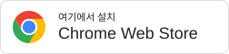

<a id="top"></a>

<p align="center">
  
</p>

<h1 align="center">✨ Roblox Customizer</h1>

<p align="center">
  
</p>

<p align="center">
  사용자 지정 배경, 반투명 패널과 홈·친구·아바타·게임·서버 도구로 나만의 Roblox를 꾸며 보세요.<br>
  Chrome과 Edge에서 사용할 수 있으며 밝은 테마와 어두운 테마를 지원합니다.
</p>

<p align="center">
  🧩 Chrome · Edge &nbsp; 🌓 밝은·어두운 테마 &nbsp; 💾 로컬 저장 &nbsp; 🌍 7개 언어 지원
</p>

<p align="center">
  <a href="https://chromewebstore.google.com/detail/roblox-customizer/docflecekjjcekdcapolmneiomimiboi">
    
  </a>
</p>

<p align="center">
  <a href="README.md">English</a> · <a href="README.zh-CN.md">简体中文</a> · <a href="README.zh-TW.md">繁體中文</a> · <a href="README.id.md">Bahasa Indonesia</a> · <a href="README.ja.md">日本語</a> · <a href="README.th.md">ไทย</a> · <strong>한국어</strong>
</p>

<p align="center">
  <a href="#installation">설치</a> ·
  <a href="#quick-start">빠른 시작</a> ·
  <a href="#features">기능</a> ·
  <a href="#languages">지원 언어</a> ·
  <a href="#data-and-backups">데이터와 백업</a> ·
  <a href="#troubleshooting-and-feedback">도움말</a>
</p>

<details>
<summary><strong>🖼️ 미리 보기</strong></summary>

<p align="center">
  
</p>

</details>

---

<a id="installation"></a>

## 📦 설치

[Chrome 웹 스토어](https://chromewebstore.google.com/detail/roblox-customizer/docflecekjjcekdcapolmneiomimiboi)에서 설치한 뒤 열려 있는 Roblox 페이지를 새로고침하세요.

<details>
<summary><strong>Chrome 또는 Edge에서 저장소를 수동으로 불러오기</strong></summary>

1. 이 저장소를 다운로드하거나 복제합니다. ZIP 파일이라면 먼저 압축을 풉니다.
2. `chrome://extensions` 또는 `edge://extensions`를 열고 **개발자 모드**를 켭니다.
3. **압축해제된 확장 프로그램을 로드합니다**를 선택하고 `manifest.json`이 있는 폴더를 지정합니다.
4. Roblox를 새로고침합니다.

실행에 필요한 파일이 저장소에 포함되어 있어 설치 전에 빌드할 필요가 없습니다. 확장 프로그램 폴더는 고정된 위치에 보관하세요.

수동으로 업데이트할 때는 파일을 교체한 뒤 확장 프로그램 관리 페이지에서 **새로고침**하고 Roblox도 다시 새로고침하세요.

</details>

처음 방문하면 서비스 약관 동의를 요청합니다. 동의 상태는 이 브라우저에 저장되며 **모두 초기화** 후에도 유지됩니다.

Roblox에 처음 방문하면 언어 및 확장 프로그램 알림이 끝난 뒤 첫 사용 안내가 자동으로 표시됩니다. **Roblox 톱니바퀴 → Roblox Customizer**와 **브라우저 도구 모음의 Roblox Customizer 아이콘**을 통한 두 가지 진입 방법과 **설정 열기** 버튼을 제공합니다. 업데이트 안내는 첫 사용 안내 다음에 표시되며, 둘 다 설정을 먼저 열 필요가 없습니다. 닫은 상태는 각각 기억하며, 새 공지 ID를 지정하면 업데이트 안내만 다시 표시됩니다.

<a id="quick-start"></a>

## 🚀 빠른 시작

Roblox를 연 뒤 브라우저 도구 모음의 확장 프로그램 아이콘이나 Roblox 톱니바퀴 메뉴의 **Roblox Customizer**를 클릭하세요. 설정은 자동으로 저장됩니다.

| 설정 분류 | 관리할 수 있는 항목 |
| --- | --- |
| **모양** | 배경 파일, 어둡게 하기, 반투명 패널의 흐림과 불투명도, 투명 효과, 사용자 지정 색상과 웹사이트 글꼴. |
| **홈 페이지** | 홈 배너, 인사말, 시계, 친구 행 수, 추천, 플레이 시간과 최근 서버 기록. |
| **고정 게임** | 고정 기능 켜기·끄기, 저장된 게임과 폴더 보기. |
| **소셜** | 게임·커뮤니티·프로필 페이지별 X 및 YouTube 피드. |
| **통화** | Robux 환산 추정치와 표시 통화. |
| **언어 및 데이터** | 확장 프로그램 언어, 백업, 복원과 초기화. |

게임을 고정하려면 게임 페이지에서 **게임 고정**을 선택하고 폴더를 지정하세요. 친구는 프로필의 **친구 고정**이나 홈·내 친구 페이지의 **고정한 친구 관리**에서 추가할 수 있습니다.

**홈 → 홈 친구**에서 **Roblox 기본 친구 목록 표시**와 **고정한 친구 표시**를 각각 켜거나 끌 수 있습니다. 숨겨도 저장한 고정 목록은 유지되며, 새로고침 후에도 설정을 기억합니다.

**홈 페이지 → 홈 배너**에서 **배너 배경과 테두리 표시**를 끄면 바깥쪽 반투명 배경과 테두리만 숨길 수 있습니다. 아바타, 인사말, 시계, 플레이 시간 카드는 계속 표시되며 설정은 자동으로 저장됩니다.

<a id="features"></a>

## ✨ 기능

### 🎨 모양과 홈

- 로컬 이미지, 움직이는 GIF 또는 MP4 동영상을 배경으로 사용하고 맞춤 방식과 밝기를 조정할 수 있습니다.
- 패널의 흐림과 불투명도를 조정하거나 흐림·투명 효과를 끌 수 있습니다. 실험적 색상 설정으로 텍스트·배경·강조 색상을 선택할 수 있습니다.
- 최대 32 MB의 로컬 TTF, OTF, WOFF, WOFF2 글꼴을 불러옵니다. 미리 보기, 일시 끄기, 기본 글꼴 복원을 지원하며 없는 문자는 대체 글꼴로 표시합니다.
- 홈 인사말과 시계를 꾸밀 수 있습니다. 배너, 아바타, 이름, 인사말, 시간, 날짜와 가장 많이 플레이한 게임 카드를 각각 표시하거나 숨길 수 있습니다.
- 기본 친구 목록을 최대 세 행으로 펼치고, 고정한 친구를 홈에 모으며, 고정 게임을 폴더로 정리할 수 있습니다.
- 즐겨찾기·주목할 만한 게임·추천 영역을 표시하거나 숨기고 개별 추천 게임도 숨길 수 있습니다.

### 👥 친구와 팔로워

친구 도구는 Roblox 기본 도구 모음과 카드에 기능을 추가합니다. 기존 아바타, 메뉴, 채팅, 참가 버튼과 페이지 이동은 그대로 사용합니다.

- 온라인, 게임 중, 오프라인, Studio 또는 고정 상태로 필터링합니다. 표시 이름, 사용자 이름, 온라인 우선 또는 고정 우선으로 정렬할 수 있습니다.
- 기본 카드의 체크박스로 사용자를 선택합니다. 페이지를 넘겨도 선택이 유지되며 현재 페이지나 필터 결과 전체를 선택할 수 있습니다.
- 선택한 사용자의 친구 삭제·팔로우 해제 또는 친구 요청 수락·무시를 일괄 처리합니다. 제출 전에 대상 목록을 확인하고 진행 상황과 실패 결과를 볼 수 있으며 현재 작업이 끝난 뒤 후속 처리를 중지할 수 있습니다.
- 친구 프로필, 기본 친구 목록 또는 관리 창에서 고정하거나 해제합니다. 이 브라우저에서 Roblox 계정별로 따로 저장합니다.
- Roblox의 집계 API를 사용할 수 있으면 기본 팔로워 제목에 `500+` 대신 전체 수를 표시합니다.

친구 삭제는 Roblox의 친구 관계를 변경하며 확장 프로그램에서 되돌릴 수 없습니다. 고정은 로컬 홈 목록만 바꿉니다.

### 🎮 게임과 서버

- 게임 페이지에서 배지·게임패스 정보, 비공개 서버 카드와 **게임 메모** 패널을 사용할 수 있습니다.
- 플레이어 수 범위, 만원이 아닌 서버, 국가, 도시와 Ping으로 공개 서버를 검색합니다. 연결 정보 정렬, 무작위 정렬·참가와 선호 도시 대체 선택도 지원합니다.
- 대화형 지구본을 드래그·확대·축소하거나 국가를 클릭하고 이름을 검색해 지역을 선택할 수 있습니다.
- 데이터가 있을 때 서버 성능, Roblox가 제공하는 언어 일치 인원과 실행 중인 플레이스 버전을 표시합니다. 언어 일치는 Roblox 웹사이트 언어를 따르며 플레이어가 실제로 사용하는 언어를 확인하는 기능은 아닙니다.
- 최근 서버에 다시 참가하거나 이용 가능 여부를 확인하고 게임별 기록을 지울 수 있습니다. 하위 플레이스 방문은 해당 게임에 묶어 기록합니다. **홈 페이지 → 최근 서버**에서 플레이 시간과 별개로 기록을 설정할 수 있습니다.

서버 필터는 새로고침하거나 페이지를 이동하면 초기화됩니다. 지역과 개수는 불러온 데이터를 기준으로 하며 서버 생성 시각순 정렬에는 신뢰할 수 있는 시작 시간이 필요합니다. 최근 서버 확인은 공개 서버를 최대 500개 조회하고 결과가 불완전하면 알 수 없음으로 남깁니다. 만원이거나 닫혔거나 접근이 제한된 서버는 참가를 거절할 수 있습니다.

### 🧍 아바타와 애니메이션 미리 보기

- Roblox 기본 3D 아바타 미리 보기와 별도의 2D 미리 보기를 나란히 사용합니다. 분류와 아이템 목록은 화면 크기에 맞춰 배치됩니다.
- **내 아바타**에서 **아바타 도구**를 펼쳐 신체 여섯 부위의 RGB 색상을 편집하거나 지원되는 착용 액세서리의 위치·회전·크기를 Roblox 허용 범위 안에서 조정할 수 있습니다.
- 로컬에서 변경 내용을 미리 본 다음 **색상 적용** 또는 **액세서리 적용**을 선택하면 로그인한 아바타에 저장됩니다. Roblox 기본 미리 보기는 페이지를 새로고침하면 업데이트됩니다.
- 애니메이션 번들, 개별 애니메이션과 이모트 페이지에서 **내 아바타로 미리 보기**를 선택하면 현재 액세서리를 유지한 채 동작을 볼 수 있습니다. 기존 동작 선택과 재생 조작도 동기화됩니다.

애니메이션 미리 보기는 R15 리그로 로컬에서 실행되며 화면 밖이나 백그라운드 탭에서는 일시 정지됩니다. 미리 보기로 착용 아이템을 바꾸거나 의상을 저장하지 않습니다.

### 🧰 아이템 정보와 리소스 탐색기

- 카탈로그, 번들, 라이브러리와 Creator Store 에셋의 기존 정보에 ID, 확인 가능한 날짜, 판매·수량 데이터를 보충합니다. 구매·착용 미리 보기 조작을 유지하면서 ID를 복사할 수 있습니다.
- 접근 가능한 리소스를 필요할 때 불러와 객체 트리, 읽기 전용 속성, 참조 이동, 검색, 값 복사와 파일 내보내기를 사용할 수 있습니다.
- XML, JSON, RBXM 모델과 LZ4·Zstandard 압축을 읽고 지원되는 이미지·오디오·동영상을 미리 볼 수 있습니다.

접근은 Roblox 권한을 따르며 파일은 실행하지 않고 읽습니다. 로드 한도는 32 MB, 모델 인스턴스 5,000개, 압축 해제된 바이너리 블록 128 MB입니다. 텍스트 미리 보기는 최대 131,072자이며 복사와 텍스트 내보내기는 읽을 수 있는 전체 값을 유지합니다.

### ⏱️ 플레이 시간, 메모, 피드와 통화

- **플레이 시간:** 계정별 추정치, 홈 요약, 검색 가능한 기록과 JSON 내보내기를 제공합니다. 설정에서 기록을 일시 정지할 수 있습니다. 브라우저 실행 중의 Roblox 상태를 사용하므로 과거 세션이나 브라우저 종료 중의 시간은 복구할 수 없습니다.
- **게임 메모:** 게임 페이지별로 최대 5,000자의 개인 메모를 자동 저장합니다. 이 브라우저의 Roblox 계정들이 공유하며 Roblox에 게시되지 않습니다.
- **소셜 피드:** 지원되는 게임·커뮤니티·프로필 페이지에 X와 YouTube 패널을 표시하고 페이지 종류별로 켜거나 끌 수 있습니다.
- **Robux 추정치:** Roblox와 Creator Hub에서 통화 환산 참고 금액을 표시합니다. 실제 결제 가격은 다를 수 있습니다.

<a id="languages"></a>

## 🌐 지원 언어

전체 페이지 개선 기능은 **영어, 중국어 간체, 중국어 번체, 인도네시아어, 일본어, 태국어와 한국어**를 지원합니다.

**언어 및 데이터 → 확장 프로그램 언어**에서 표시 언어를 선택하거나 **자동**으로 Roblox를 따르게 할 수 있습니다. `/ja/`, `/th/`, `/ko/` 같은 지역화 경로도 지원합니다.

Roblox가 다른 언어를 사용하면 대체 모드로 전환됩니다. 기본 배치를 유지하면서 이미지·GIF 배경, 사용자 지정 색상과 글꼴을 사용할 수 있습니다. 전체 기능을 복원하려면 **Roblox 웹사이트 언어**를 지원 언어로 바꾸세요. 확장 프로그램 표시 언어만 바꾸면 대체 모드가 해제되지 않습니다.

<a id="data-and-backups"></a>

## 💾 데이터와 백업

설정과 저장된 내용은 이 브라우저에 보관됩니다. Roblox 데이터, 피드, 환율이나 서버 지역을 읽는 기능은 [개인정보 처리방침](PRIVACY.ko.md)에 설명된 관련 서비스에 연결합니다.

| 데이터 | 저장 범위 | 전체 설정 백업 |
| --- | --- | --- |
| 설정, 배경 파일과 글꼴 파일 | 이 브라우저 | 포함 |
| 고정 게임과 폴더 | 이 브라우저의 Roblox 계정들이 공유 | 포함 |
| 고정한 친구 | Roblox 계정별로 분리 | 포함 |
| 플레이 시간 기록 | Roblox 계정별로 분리 | 저장된 기록 포함 |
| 게임 메모 | 이 브라우저의 Roblox 계정들이 공유 | 포함 |
| 최근 서버 | Roblox 계정별로 분리 | 제외 |
| 현재 서버 필터 | 현재 페이지만 | 제외 |

최근 사용한 계정 최대 열 개에 대해 게임별로 서버 여섯 개까지 기록합니다. 숨겨진 서버 ID는 복구할 수 없습니다.

**언어 및 데이터 → 백업 및 복원**에서 전체 백업을 내보내거나 가져올 수 있습니다. **가져오기는 기존 확장 프로그램 데이터를 교체합니다.** 초기화하거나 다른 브라우저로 옮기기 전에 내보내세요.

**모두 초기화**는 메모·최근 서버 기록을 포함한 저장 데이터를 삭제하고 지원되는 사이트 캐시를 지웁니다. 약관 동의는 유지됩니다. 제거 전에 저장 데이터를 지우려면 확장 프로그램이 설치된 상태에서 초기화하세요.

자세한 내용은 [개인정보 처리방침](PRIVACY.ko.md)과 [서비스 약관](TERMS.ko.md)을 확인하세요. 확장 프로그램의 정책 링크는 표시 언어에 맞는 GitHub 공개 문서를 엽니다.

<a id="troubleshooting-and-feedback"></a>

## 🛠️ 문제 해결과 피드백

- **업데이트가 보이지 않음:** 수동 설치라면 `chrome://extensions` 또는 `edge://extensions`에서 확장 프로그램을 새로고침한 다음 Roblox를 새로고침하세요. 웹페이지만 새로고침하면 manifest나 백그라운드 변경 사항이 적용되지 않을 수 있습니다.
- **일부 기능이 표시되지 않음:** Roblox 웹사이트 언어가 지원 목록에 있는지 확인하세요. API에 의존하는 기능은 일시적으로 이용할 수 없을 수도 있습니다.
- **요소가 겹치거나 페이지가 이상하게 동작함:** 다른 확장 프로그램이 같은 요소를 수정할 수 있습니다. 호환성 알림은 일부 알려진 Roblox 확장 프로그램을 인식합니다. 문제를 확인할 때 겹치는 기능을 조정해 보세요. 알림이 다른 확장 프로그램을 끄지는 않습니다.
- **데이터를 불러오지 못함:** Roblox나 외부 서비스가 복구되면 다시 시도하세요. 확장 프로그램은 API가 제공하지 않는 서버 정보를 만들거나 리소스 접근 권한을 우회할 수 없습니다.

도움이 필요하면 [lunar@lunarfox.my](mailto:lunar@lunarfox.my)로 문의하세요. 해당 페이지 URL, 브라우저와 버전, Roblox 언어, 재현 단계와 스크린샷을 포함해 주세요.

<a id="development"></a>

## 🧑‍💻 개발

설치에는 저장소에 포함된 파일을 그대로 사용합니다. 개발과 테스트에는 Node.js를 사용합니다.

**업데이트 안내 편집:** 영어는 [UPDATE.md](UPDATE.md), 한국어는 [UPDATE.ko.md](UPDATE.ko.md), 나머지 언어는 `UPDATE.zh-CN.md`, `UPDATE.zh-TW.md`, `UPDATE.id.md`, `UPDATE.ja.md`, `UPDATE.th.md`에서 각각 편집합니다. 현재 확장 프로그램 언어에 맞는 파일만 읽으며 언어를 바꾸면 본문도 갱신합니다. 번역이 없거나 형식이 잘못되면 영어로 표시합니다. 모든 번역에 같은 `id`를 사용하면 언어를 바꿔도 읽은 안내가 다시 뜨지 않습니다. 문구 수정 시 ID를 유지하고 새 안내를 게시할 때는 모든 번역을 `1.2.1` 같은 새 ID로 변경하세요. `enabled: false`는 해당 언어만 끄며 영어로 대체하지 않습니다. 빌드 없이 확장 프로그램과 Roblox를 새로고침하면 됩니다. 설정 하단의 **업데이트 안내**에서 다시 볼 수 있습니다.

소스를 수정한 뒤 해당 생성 파일을 다시 만드세요.

| 수정한 소스 | 명령 |
| --- | --- |
| 백그라운드 모듈과 번들에 포함되는 종속성 | `node scripts/build-service-worker.cjs` |
| 페이지 브리지, 경로, 호환성, 서버 카드 또는 기본 친구 도우미 | `node scripts/build-page-bridge.cjs` |
| `src/legal/content.json`의 정책 본문 | `node scripts/build-legal-docs.cjs` |

번들을 확인하고 패키지·라벨·백업 검사를 실행합니다.

```sh
node scripts/build-service-worker.cjs --check
node scripts/build-page-bridge.cjs --check
node --test tests/extension-package.test.cjs tests/native-labels.test.cjs tests/backup.test.cjs
```

브라우저 테스트는 독립된 프로필과 로컬 모의 페이지를 사용합니다. `CHROME_BIN`을 Chrome 또는 Chromium 실행 파일로 지정하세요. 실제 확장 프로그램 주입 테스트에는 `CHROME_EXTENSION_TESTS=1`, 압축 해제된 확장 프로그램을 지원하는 Chrome for Testing 또는 Chromium, Roblox React 번들의 로컬 복사본을 가리키는 `SERVER_VIEW_REACT_BUNDLE`이 추가로 필요합니다.

```sh
node --test tests/extension-server-metadata-browser.test.cjs
```

리소스 탐색기의 속성과 열거형 참조 데이터는 `node scripts/build-model-schema.cjs`로 업데이트할 수 있습니다.

<a id="license-and-credits"></a>

## 📜 라이선스와 크레딧

[GNU GPL v3](LICENSE) 라이선스로 제공됩니다. 포함된 타사 구성 요소에는 각자의 라이선스와 고지가 적용됩니다. [fzstd](src/assets/vendor/fzstd.LICENSE)와 [애니메이션 미리 보기 렌더러 및 종속성](src/assets/animation-preview/vendor/README.md)을 참고하세요.

---

<p align="center">
  <a href="#top">⬆️ 맨 위로</a>
</p>
