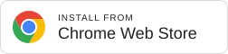

  

<h1 align="center">Roblox Customizer</h1>

  

  Custom backgrounds, frosted panels, and useful tools across Roblox. 
  Make your Home feel like home, in light or dark mode.

  

  

  <a href="#-features">Features</a> ·
  <a href="#-installation">Installation</a> ·
  <a href="#-quick-start">Quick start</a> ·
  English / <a href="README.zh-CN.md">简体中文</a>

## 🖼️ Preview

  

## ✨ Features

<table>
  <tr>
    <td width="50%">
      <h3>🖼️ Backgrounds</h3>
      Local images, GIFs, and MP4 videos, with image fit and dimming controls.
    </td>
    <td width="50%">
      <h3>🎨 Appearance</h3>
      Adjustable glass blur and opacity, local font files, plus experimental text, background, and accent colors.
    </td>
  </tr>
  <tr>
    <td>
      <h3>🏠 Personalized Home</h3>
      Greetings, a clock, up to three friend rows, pinned games and folders, and recommendation controls. Hide the Home banner or choose its avatar, name, greeting, time, date, and most-played card separately.
    </td>
    <td>
      <h3>⏱️ Local playtime</h3>
      Account-specific estimates, Home summaries, searchable history, and JSON export. Pause tracking in settings.
    </td>
  </tr>
  <tr>
    <td>
      <h3>🎮 Game tools</h3>
      Badge and gamepass details and private-server cards. Combine player ranges, not-full, country/city and ping filters with connection sorting, shuffle, random join and preferred-city fallback. Rotate and zoom an interactive globe, click a country, or search country names to select a region. Geographic assets ship locally and load when expanded. Locations and counts use loaded servers; age sorting requires verified start times.
    </td>
    <td>
      <h3>💬 Social feeds</h3>
      Enable X and YouTube separately on Game, Community, and Profile pages.
    </td>
  </tr>
</table>

**💱 Robux estimates:** Approximate currency equivalents on Roblox and Creator Hub; checkout prices may differ.

**📝 Game notes:** Add private reminders or strategies in the Game notes panel on a game page. Notes save automatically and can be edited or deleted, with up to 5,000 characters per game page. They stay in this browser, are shared across your Roblox accounts, and are not posted to Roblox. Settings backups include notes, imports replace them, and Reset All deletes them.

Server filters apply only to the current page and reset on refresh or navigation. Selections are not written to local storage or settings backups.

Globe dragging uses a canvas preview with cached map coordinates; releasing restores the detailed, selectable SVG boundaries. City markers are reused, sidebar updates wait until dragging ends, and unchanged filter updates leave the globe idle.

Public server cards also show performance relative to 60 server FPS, Roblox-reported language matches, and the place version running on that server when those fields are available. Language matches use the Roblox website language, independently of the extension UI language, and do not confirm what players actually speak. Place versions reuse the server connection request used for country lookup; version-only requests skip IP geolocation when the country is already known. Supplemental join requests are cached, deduplicated and limited to two at a time. Unavailable fields stay hidden, and the original Join action is preserved.

**↩️ Recent servers:** Each game's Servers tab shows its own recent-server list, including visits to that game's subplaces. Rejoin, check availability, or clear just that game's list. Each of the 10 most recently used accounts retains up to 6 servers per game; a new entry replaces that game's oldest. Settings show all lists grouped by game under **Home page → Recent servers**, with recording controlled separately from playtime.

**Streamer mode:** In **Settings → Privacy**, enable Streamer mode and choose whether to hide Robux balances, friends, and messages/notifications. It masks supported website elements and remembers your choices, including on refresh.

**Animation previews:** Animation bundles, individual catalog animations, and emotes show the native motion player beside an optional preview on your avatar. Select **Preview on my avatar** to load your current avatar and play the selected animation while keeping its accessories. Bundle action selection and native play/pause controls stay synchronized; individual movement animations use their actual type, and emotes play directly on the avatar. Reset the camera or reload the avatar when needed. The preview uses an R15 rig, runs locally at up to 30 FPS, pauses off-screen/in background tabs, and does not equip items or save outfits. The renderer, its licenses, and corresponding source are packaged locally; see [dependency notices](src/assets/animation-preview/vendor/README.md).

**Item tools:** Item IDs, available dates, and reported sales/quantity fields extend the original item details on catalog, bundle, library, and Creator Store asset pages. Existing fields stay in place and are not duplicated; Copy ID appears beside the ID. Use Roblox's original preview and try-on controls, or the compact detail actions for Creator Store, refresh, and export. The resource explorer has an object tree and read-only property pane, model/property filters, reference navigation, copy controls, and a text viewer. It reads XML, JSON, and RBXM files, including LZ4 and Zstandard compression, and previews supported image/audio/video files. File loading is limited to 32 MB, with at most 5,000 model instances and 128 MB of expanded binary chunks. Text previews show up to 131,072 characters; copy and text export retain the available full value. Unsupported property types are identified individually. Files are never executed, and access permissions follow Roblox.

The explorer UI and model reader are independently implemented. Zstandard decoding uses [fzstd 0.1.1](https://github.com/101arrowz/fzstd) under its [MIT license](src/assets/vendor/fzstd.LICENSE). Property categories and enum names are bundled from Roblox's published Studio API data; `node scripts/build-model-schema.cjs` refreshes that reference data. No BTRoblox application code or icon sprites are included.

**Avatar tools:** On **My avatar**, expand **Avatar tools** for six full RGB body colors and position, rotation, and scale controls for supported equipped accessories. Limits come from Roblox. Preview edits stay local until you select **Apply colors** or **Apply accessory**, which changes your signed-in Roblox avatar. Refresh the page to update Roblox's native preview. This tool preserves other worn items and does not purchase items.

## 📦 Installation

<strong>🛠️ Install manually in Chrome or Edge</strong>

To load the extension from this repository:

1. Download or clone this repository and extract it if needed.
2. Open `chrome://extensions` or `edge://extensions` and enable **Developer mode**.
3. Click **Load unpacked** and select the folder containing `manifest.json`.
4. Refresh Roblox. Open settings from the extension's toolbar icon or **Roblox Customizer** in Roblox's settings gear menu.

No build step is needed to install. Keep the extension folder in a permanent location.

> [!NOTE]
> The first time you visit Roblox after installing, a Terms of Service prompt appears automatically. Acceptance is remembered in this browser, including after **Reset All**.

## 🚀 Quick start

- Choose a background and adjust its fit, dimming, blur, and opacity in **Appearance**. Changes save automatically. On returning to a tab, animated wallpapers resume before optional page updates, which run in small batches. Saved files are reused during recovery, and stalled videos recover without reloading the page.
- In **Appearance → Website font**, choose a TTF, OTF, WOFF, or WOFF2 file (up to 32 MB) to replace Roblox text fonts. Preview it, toggle it off, or restore the default font. Missing characters use fallback fonts.
- Click **Pin Game** on a game page, choose a folder, and confirm. Manage folders from **Pinned Games** on Home.
- Turn off **Enable Pinned Games** in **Settings → Pinned Games** to disable the Home section and pin buttons on game pages. View your saved games and folders in this settings category, even while the feature is disabled.
- Open a game's **Servers** tab, set your filters, and click **Search**.
- Use **Backup and restore** to export your settings, backgrounds, pins, and playtime. Import replaces existing extension data.

## 🌐 Language support

Full features require Roblox's language to be **English, Simplified Chinese, Traditional Chinese, Indonesian, Japanese, Thai, or Korean**. Other languages use fallback mode: image/GIF backgrounds, custom colors, and custom fonts remain available, while Roblox's native layout is preserved.

Choose **日本語** under **Language & data → Extension language**, or use Automatic with Roblox set to Japanese. Japanese pages with `/ja/` or `/ja-jp/` paths are supported.

Choose **ไทย** for Thai, or use Automatic with Roblox set to Thai. Thai pages with `/th/` or `/th-th/` paths are supported.

Choose **한국어** for Korean, or use Automatic with Roblox set to Korean. Korean pages with `/ko/` or `/ko-kr/` paths are supported.

Switch Roblox's language to restore all features. Changing only the extension's interface language does not leave fallback mode.

## 💾 Data and limitations

Known Roblox extensions such as BTRoblox, RoPro, RoGold and RoSeal can trigger an advisory when their page markers or recognized extension-resource URLs are detected. The notice explains how broad changes to the Roblox interface can interact with other extensions, causing duplicated controls, overlapping elements or display/loading problems. Users can keep using multiple extensions together; adjusting overlapping features is optional troubleshooting if problems occur. Select **Got it, continue using Roblox** to dismiss it; acknowledged extensions do not trigger the same notice again, while a newly detected extension can. Detection stays local and is not a complete list of installed extensions. Other extensions are not disabled or changed.

Preferences, backgrounds, pinned games, and playtime history are stored locally in your browser. Playtime is estimated from Roblox presence while the browser runs; past sessions and time while the browser is closed cannot be recovered.

Recent servers are recorded from confirmed Roblox presence while the browser runs; hidden server IDs cannot be recovered. Rejoining opens the Roblox app, and full, closed, or restricted servers may reject the join. Availability checks scan up to 500 public servers; an incomplete scan remains unknown. Recent-server history is excluded from full backups. Reset All removes saved server history.

Server data, feeds, and currency rates depend on Roblox and external services. Retry unavailable data later. Export a backup and use **Reset All** before uninstalling to remove saved backgrounds and site caches as well.

Read the published [Privacy Policy](https://github.com/ShadowsLunarfox/Roblox-Customizer/blob/main/PRIVACY.md) and [Terms of Service](https://github.com/ShadowsLunarfox/Roblox-Customizer/blob/main/TERMS.md) on GitHub. Settings and the first-visit prompt open the version matching the extension's language. Contact [lunar@lunarfox.my](mailto:lunar@lunarfox.my) for support or privacy questions.

## 💬 Updates and feedback

Replace the extension files, reload the extension, and refresh Roblox. For problems, include the page URL, browser version, reproduction steps, and a screenshot.

<strong>🔧 Working on the extension?</strong>

After editing background worker sources, rebuild the checked-in bundle with `node scripts/build-service-worker.cjs`.
After editing the page bridge, route helpers, compatibility guard or server-card view, run `node scripts/build-page-bridge.cjs`. The MAIN-world entry includes its own dependencies because Chrome de-duplicates content-script files shared across execution worlds.

The real extension injection regression is `node --test tests/extension-server-metadata-browser.test.cjs`. Set `CHROME_EXTENSION_TESTS=1`, `CHROME_BIN` to Chrome for Testing or Chromium, and `SERVER_VIEW_REACT_BUNDLE` to a local copy of Roblox's React bundle. The test uses a fresh profile, the actual manifest and local network fixtures.

The extension links to the policy Markdown files on GitHub's `main` branch. Published policy updates appear there without requiring an extension update.

Licensed under [GNU GPL v3](LICENSE).

  <a href="#roblox-customizer">↑ Back to top</a>

