<a id="top"></a>

<p align="center">
  
</p>

<h1 align="center">✨ Roblox Customizer</h1>

<p align="center">
  
</p>

<p align="center">
  ปรับ Roblox ด้วยพื้นหลังที่เลือกเอง แผงกระจกฝ้า และเครื่องมือสำหรับหน้าหลัก เพื่อน อวาตาร์ เกม และเซิร์ฟเวอร์<br>
  ใช้ได้กับ Chrome และ Edge รองรับธีมสว่างและมืด
</p>

<p align="center">
  🧩 Chrome · Edge &nbsp; 🌓 ธีมสว่างและมืด &nbsp; 💾 บันทึกในเครื่อง &nbsp; 🌍 รองรับ 7 ภาษา
</p>

<p align="center">
  <a href="https://chromewebstore.google.com/detail/roblox-customizer/docflecekjjcekdcapolmneiomimiboi">
    
  </a>
</p>

<p align="center">
  <a href="README.md">English</a> · <a href="README.zh-CN.md">简体中文</a> · <a href="README.zh-TW.md">繁體中文</a> · <a href="README.id.md">Bahasa Indonesia</a> · <a href="README.ja.md">日本語</a> · <strong>ไทย</strong> · <a href="README.ko.md">한국어</a>
</p>

<p align="center">
  <a href="#installation">การติดตั้ง</a> ·
  <a href="#quick-start">เริ่มต้นใช้งาน</a> ·
  <a href="#features">ฟีเจอร์</a> ·
  <a href="#languages">ภาษา</a> ·
  <a href="#data-and-backups">ข้อมูลและการสำรอง</a> ·
  <a href="#troubleshooting-and-feedback">ความช่วยเหลือ</a>
</p>

<details>
<summary><strong>🖼️ ตัวอย่าง</strong></summary>

<p align="center">
  
</p>

</details>

---

<a id="installation"></a>

## 📦 การติดตั้ง

ติดตั้งจาก [Chrome เว็บสโตร์](https://chromewebstore.google.com/detail/roblox-customizer/docflecekjjcekdcapolmneiomimiboi) แล้วรีเฟรชหน้า Roblox ที่เปิดอยู่

<details>
<summary><strong>โหลดจากคลังซอร์สโค้ดด้วยตนเองใน Chrome หรือ Edge</strong></summary>

1. ดาวน์โหลดหรือโคลนคลังซอร์สโค้ดนี้ หากเป็นไฟล์ ZIP ให้แตกไฟล์ก่อน
2. เปิด `chrome://extensions` หรือ `edge://extensions` แล้วเปิด **โหมดนักพัฒนาซอฟต์แวร์**
3. เลือก **โหลดส่วนขยายที่คลายการแพ็กแล้ว** และเลือกโฟลเดอร์ที่มี `manifest.json`
4. รีเฟรช Roblox

คลังซอร์สโค้ดมีไฟล์ที่จำเป็นสำหรับใช้งานส่วนขยายแล้ว จึงไม่ต้องบิลด์ก่อนติดตั้ง โปรดเก็บโฟลเดอร์ส่วนขยายไว้ในตำแหน่งเดิม

หากอัปเดตด้วยตนเอง ให้แทนที่ไฟล์ กด **โหลดซ้ำ** ในหน้าจัดการส่วนขยาย แล้วรีเฟรช Roblox อีกครั้ง

</details>

เมื่อเข้าครั้งแรก ส่วนขยายจะขอให้ยอมรับข้อกำหนดการใช้บริการ เบราว์เซอร์นี้จะจำการยอมรับไว้ แม้ใช้ **รีเซ็ตทั้งหมด** แล้วก็ตาม

เมื่อเข้า Roblox ครั้งแรก คำแนะนำจะแสดงอัตโนมัติหลังแจ้งเตือนภาษาและความเข้ากันได้จบ โดยอธิบายทางเข้าสองแบบ: **รูปเฟือง Roblox → Roblox Customizer** หรือ **ไอคอน Roblox Customizer บนแถบเครื่องมือเบราว์เซอร์** พร้อมปุ่ม **เปิดการตั้งค่า** ประกาศอัปเดตจะแสดงต่อจากคำแนะนำ ทั้งสองอย่างไม่ต้องเปิดการตั้งค่าก่อน ระบบจำการปิดแยกกัน และ ID ประกาศใหม่จะแสดงเฉพาะประกาศใหม่อีกครั้ง

<a id="quick-start"></a>

## 🚀 เริ่มต้นใช้งาน

เปิด Roblox แล้วคลิกไอคอนส่วนขยายบนแถบเครื่องมือเบราว์เซอร์ หรือเลือก **Roblox Customizer** ในเมนูรูปเฟืองของ Roblox การตั้งค่าจะบันทึกอัตโนมัติ

| หมวดการตั้งค่า | สิ่งที่จัดการได้ |
| --- | --- |
| **รูปลักษณ์** | ไฟล์พื้นหลัง ความมืด ความเบลอและความทึบของกระจก ความโปร่งใส สีที่กำหนดเอง และแบบอักษรเว็บไซต์ |
| **หน้าหลัก** | แบนเนอร์ คำทักทาย นาฬิกา จำนวนแถวเพื่อน เกมแนะนำ เวลาเล่น และการบันทึกเซิร์ฟเวอร์ล่าสุด |
| **เกมที่ปักหมุด** | เปิดหรือปิดการปักหมุด และดูเกมกับโฟลเดอร์ที่บันทึกไว้ |
| **โซเชียล** | เปิดฟีด X และ YouTube แยกกันในหน้าเกม ชุมชน และโปรไฟล์ |
| **สกุลเงิน** | มูลค่า Robux โดยประมาณและสกุลเงินที่ต้องการ |
| **ภาษาและข้อมูล** | ภาษาของส่วนขยาย การสำรอง กู้คืน และรีเซ็ต |

หากต้องการปักหมุดเกม ให้เลือก **ปักหมุดเกม** ในหน้าเกมแล้วเลือกโฟลเดอร์ สำหรับเพื่อน ให้เลือก **ปักหมุดเพื่อน** ในโปรไฟล์ หรือเปิด **จัดการเพื่อนที่ปักหมุด** จากหน้าหลักหรือหน้าเพื่อนของคุณ

ใน **หน้าหลัก → เพื่อนบนหน้าหลัก** คุณสามารถเปิดหรือปิด **แสดงรายชื่อเพื่อนเดิมของ Roblox** และ **แสดงเพื่อนที่ปักหมุด** แยกกันได้ การซ่อนส่วนเหล่านี้จะเก็บรายการปักหมุดไว้ และจำตัวเลือกของคุณหลังโหลดหน้าใหม่

ใน **หน้าหลัก → แบนเนอร์หน้าหลัก** ปิด **แสดงพื้นหลังและกรอบแบนเนอร์** เพื่อซ่อนพื้นหลังกระจกฝ้าและกรอบชั้นนอก โดยยังแสดงอวาตาร์ คำทักทาย นาฬิกา และการ์ดเวลาเล่น ระบบจะบันทึกตัวเลือกนี้โดยอัตโนมัติ

<a id="features"></a>

## ✨ ฟีเจอร์

### 🎨 รูปลักษณ์และหน้าหลัก

- ใช้รูปภาพในเครื่อง GIF เคลื่อนไหว หรือวิดีโอ MP4 เป็นพื้นหลัง พร้อมปรับวิธีแสดงภาพและความมืด
- ปรับความเบลอและความทึบของกระจก หรือปิดความเบลอและความโปร่งใส สีแบบทดลองช่วยให้เลือกสีข้อความ พื้นหลัง และสีเน้นได้
- โหลดแบบอักษร TTF, OTF, WOFF หรือ WOFF2 ในเครื่อง ขนาดไม่เกิน 32 MB ดูตัวอย่าง ปิดชั่วคราว หรือคืนค่าแบบอักษรเดิมได้ ตัวอักษรที่ไม่มีจะใช้แบบอักษรสำรอง
- ปรับคำทักทายและนาฬิกาในหน้าหลัก แสดงหรือซ่อนแบนเนอร์ อวาตาร์ ชื่อ คำทักทาย เวลา วันที่ และการ์ดเกมที่เล่นบ่อยที่สุดแยกกันได้
- แสดงรายชื่อเพื่อนเดิมได้สูงสุดสามแถว รวมเพื่อนที่ปักหมุดไว้บนหน้าหลัก และจัดเกมที่ปักหมุดเป็นโฟลเดอร์
- เลือกแสดงหรือซ่อนรายการโปรด เกมเด่น และส่วนเกมแนะนำ หรือซ่อนเกมแนะนำเป็นรายเกม

### 👥 เพื่อนและผู้ติดตาม

เครื่องมือเพื่อนเพิ่มความสามารถให้แถบเครื่องมือและการ์ดเดิมของ Roblox โดยคงอวาตาร์ เมนู แชต ปุ่มเข้าร่วม และการแบ่งหน้าเดิมไว้

- กรองตามสถานะออนไลน์ อยู่ในเกม ออฟไลน์ Studio หรือปักหมุด เรียงตามชื่อที่แสดง ชื่อผู้ใช้ ออนไลน์ก่อน หรือที่ปักหมุดก่อนได้
- เลือกผู้ใช้ด้วยช่องทำเครื่องหมายบนการ์ดเดิม เปลี่ยนหน้าแล้วรายการที่เลือกยังอยู่ และเลือกได้ทั้งหน้าปัจจุบันหรือผลลัพธ์ที่กรองทั้งหมด
- เลิกเป็นเพื่อน เลิกติดตาม ยอมรับหรือเพิกเฉยคำขอเป็นเพื่อนทีละหลายคน ตรวจรายชื่อก่อนส่งคำสั่ง ดูความคืบหน้าและรายการที่ล้มเหลว และหยุดรายการถัดไปหลังคำสั่งปัจจุบันเสร็จได้
- ปักหมุดหรือเลิกปักหมุดจากโปรไฟล์ รายชื่อเพื่อนเดิม หรือหน้าจัดการเพื่อนที่ปักหมุด ข้อมูลแยกตามบัญชี Roblox ในเบราว์เซอร์นี้
- แสดงจำนวนผู้ติดตามเต็มในหัวข้อผู้ติดตามเดิมแทน `500+` เมื่อ API นับจำนวนของ Roblox ใช้งานได้

การเลิกเป็นเพื่อนเปลี่ยนความสัมพันธ์ใน Roblox และส่วนขยายไม่สามารถย้อนกลับได้ การปักหมุดเปลี่ยนเฉพาะรายการบนหน้าหลักที่บันทึกในเครื่อง

### 🎮 เกมและเซิร์ฟเวอร์

- ดูรายละเอียดเหรียญตรา เกมพาส การ์ดเซิร์ฟเวอร์ส่วนตัว และแผง **บันทึกเกม** ในหน้าเกม
- ค้นหาเซิร์ฟเวอร์สาธารณะตามช่วงจำนวนผู้เล่น สถานะยังไม่เต็ม ประเทศ เมือง และ Ping พร้อมเรียงตามการเชื่อมต่อ สุ่มลำดับ สุ่มเข้าร่วม และใช้เมืองสำรองตามความต้องการ
- เลือกภูมิภาคผ่านลูกโลกแบบโต้ตอบด้วยการลาก ซูม คลิกประเทศ หรือค้นหาชื่อประเทศ
- แสดงประสิทธิภาพเซิร์ฟเวอร์ จำนวนผู้เล่นที่ภาษาตรงกันตามข้อมูล Roblox และเวอร์ชันสถานที่ที่กำลังรันเมื่อมีข้อมูล การจับคู่ภาษาอิงภาษาของเว็บไซต์ Roblox และไม่ได้ยืนยันภาษาที่ผู้เล่นพูดจริง
- กลับเข้าเซิร์ฟเวอร์ล่าสุด ตรวจสอบว่ายังเข้าได้ หรือเคลียร์ประวัติของเกมนั้น การเข้าไปยังสถานที่ย่อยจะรวมกับเกมหลัก เปิดหรือปิดการบันทึกแยกจากเวลาเล่นได้ที่ **หน้าหลัก → เซิร์ฟเวอร์ล่าสุด**

ตัวกรองเซิร์ฟเวอร์จะรีเซ็ตเมื่อรีเฟรชหรือเปลี่ยนหน้า ตำแหน่งและจำนวนอิงข้อมูลที่โหลดแล้ว ส่วนการเรียงตามอายุเซิร์ฟเวอร์ต้องมีเวลาเริ่มต้นที่เชื่อถือได้ การตรวจเซิร์ฟเวอร์ล่าสุดค้นหาได้ไม่เกิน 500 เซิร์ฟเวอร์สาธารณะ หากข้อมูลไม่ครบจะแสดงว่ายังยืนยันไม่ได้ เซิร์ฟเวอร์ที่เต็ม ปิด หรือจำกัดสิทธิ์อาจปฏิเสธการเข้าร่วม

### 🧍 อวาตาร์และตัวอย่างแอนิเมชัน

- ใช้ตัวอย่างอวาตาร์ 3D เดิมของ Roblox คู่กับตัวอย่าง 2D แยกต่างหาก โดยหมวดหมู่และรายการไอเท็มปรับตามขนาดหน้าจอ
- เปิด **เครื่องมืออวาตาร์** ในหน้า **อวาตาร์ของฉัน** เพื่อแก้ไขสี RGB ของร่างกายหกส่วน หรือปรับตำแหน่ง การหมุน และขนาดของเครื่องประดับที่สวมอยู่และรองรับภายในขอบเขตของ Roblox
- ดูตัวอย่างการแก้ไขในเครื่องก่อน แล้วเลือก **ใช้สี** หรือ **ใช้การปรับแต่ง** เพื่อบันทึกลงอวาตาร์ของบัญชีที่เข้าสู่ระบบ รีเฟรชหน้าเพื่ออัปเดตตัวอย่างเดิมของ Roblox
- ในหน้าชุดแอนิเมชัน แอนิเมชันเดี่ยว และอีโมต เลือก **ดูตัวอย่างบนอวาตาร์ของฉัน** เพื่อเล่นท่าทางบนอวาตาร์ปัจจุบันพร้อมเครื่องประดับ การเลือกท่าและตัวควบคุมการเล่นเดิมจะทำงานตรงกัน

ตัวอย่างแอนิเมชันใช้โครง R15 และทำงานในเครื่อง โดยหยุดชั่วคราวเมื่ออยู่นอกหน้าจอหรือแท็บอยู่เบื้องหลัง การดูตัวอย่างไม่เปลี่ยนไอเท็มที่สวมอยู่หรือบันทึกชุดแต่งตัว

### 🧰 รายละเอียดไอเท็มและตัวสำรวจทรัพยากร

- เพิ่ม ID วันที่ที่มีข้อมูล และยอดขายหรือจำนวนไอเท็มในรายละเอียดเดิมของหน้าแค็ตตาล็อก ชุดสินค้า คลัง และ Creator Store คัดลอก ID ได้โดยคงปุ่มซื้อและลองใส่เดิมไว้
- โหลดทรัพยากรที่เข้าถึงได้เมื่อต้องการ เพื่อดูโครงสร้างวัตถุ ตรวจคุณสมบัติแบบอ่านอย่างเดียว ไปยังการอ้างอิง ค้นหา คัดลอกค่า และส่งออกไฟล์
- อ่านโมเดล XML, JSON และ RBXM รวมถึงการบีบอัด LZ4 และ Zstandard พร้อมดูตัวอย่างภาพ เสียง และวิดีโอที่รองรับ

การเข้าถึงขึ้นกับสิทธิ์ของ Roblox ไฟล์จะถูกอ่านโดยไม่สั่งให้ทำงาน จำกัดการโหลดที่ 32 MB วัตถุโมเดล 5,000 รายการ และบล็อกไบนารีหลังขยาย 128 MB ตัวอย่างข้อความแสดงได้สูงสุด 131,072 ตัวอักษร ส่วนการคัดลอกและส่งออกข้อความเก็บค่าเต็มที่อ่านได้

### ⏱️ เวลาเล่น บันทึก ฟีด และสกุลเงิน

- **เวลาเล่น:** ประมาณเวลาแยกตามบัญชี มีสรุปบนหน้าหลัก ประวัติที่ค้นหาได้ และส่งออก JSON หยุดบันทึกชั่วคราวได้ในตั้งค่า การประมาณใช้สถานะ Roblox ระหว่างที่เบราว์เซอร์ทำงาน จึงไม่สามารถย้อนเก็บเซสชันเก่าหรือเวลาที่ปิดเบราว์เซอร์ได้
- **บันทึกเกม:** บันทึกส่วนตัวสูงสุด 5,000 ตัวอักษรต่อหน้าเกมและบันทึกอัตโนมัติ ทุกบัญชี Roblox ในเบราว์เซอร์นี้ใช้ร่วมกัน โดยไม่โพสต์ลง Roblox
- **ฟีดโซเชียล:** แผง X และ YouTube ในหน้าเกม ชุมชน และโปรไฟล์ที่รองรับ พร้อมสวิตช์แยกตามประเภทหน้า
- **มูลค่า Robux โดยประมาณ:** แสดงค่าเงินอ้างอิงบน Roblox และ Creator Hub ราคาชำระเงินจริงอาจต่างออกไป

<a id="languages"></a>

## 🌐 ภาษาที่รองรับ

การปรับแต่งหน้าเต็มรูปแบบรองรับ **อังกฤษ จีนตัวย่อ จีนตัวเต็ม อินโดนีเซีย ญี่ปุ่น ไทย และเกาหลี**

เลือกภาษาที่ **ภาษาและข้อมูล → ภาษาของส่วนขยาย** หรือเลือก **อัตโนมัติ** เพื่อใช้ตาม Roblox รองรับเส้นทางภาษาท้องถิ่น เช่น `/ja/`, `/th/` และ `/ko/` ด้วย

หาก Roblox ใช้ภาษาอื่น ส่วนขยายจะเข้าสู่โหมดสำรอง โดยยังใช้พื้นหลังภาพ/GIF สีและแบบอักษรที่กำหนดเองได้ พร้อมคงเค้าโครงเดิม เปลี่ยน **ภาษาของเว็บไซต์ Roblox** เป็นภาษาที่รองรับเพื่อคืนฟีเจอร์ครบ การเปลี่ยนเฉพาะภาษาส่วนขยายจะไม่ออกจากโหมดสำรอง

<a id="data-and-backups"></a>

## 💾 ข้อมูลและการสำรอง

การตั้งค่าและเนื้อหาที่บันทึกเก็บอยู่ในเบราว์เซอร์นี้ ฟีเจอร์ที่อ่านข้อมูล Roblox ฟีด อัตราแลกเปลี่ยน หรือภูมิภาคเซิร์ฟเวอร์จะติดต่อบริการที่เกี่ยวข้องตาม[นโยบายความเป็นส่วนตัว](PRIVACY.th.md)

| ข้อมูล | ขอบเขตการจัดเก็บ | ข้อมูลสำรองการตั้งค่าทั้งหมด |
| --- | --- | --- |
| การตั้งค่า ไฟล์พื้นหลัง และแบบอักษร | เบราว์เซอร์นี้ | รวม |
| เกมที่ปักหมุดและโฟลเดอร์ | ทุกบัญชี Roblox ในเบราว์เซอร์นี้ใช้ร่วมกัน | รวม |
| เพื่อนที่ปักหมุด | แยกตามบัญชี Roblox | รวม |
| ประวัติเวลาเล่น | แยกตามบัญชี Roblox | รวมประวัติที่บันทึกไว้ |
| บันทึกเกม | ทุกบัญชี Roblox ในเบราว์เซอร์นี้ใช้ร่วมกัน | รวม |
| เซิร์ฟเวอร์ล่าสุด | แยกตามบัญชี Roblox | ไม่รวม |
| ตัวกรองเซิร์ฟเวอร์ปัจจุบัน | เฉพาะหน้าปัจจุบัน | ไม่รวม |

ประวัติเซิร์ฟเวอร์ล่าสุดเก็บได้สูงสุดหกเซิร์ฟเวอร์ต่อเกม สำหรับแต่ละบัญชีจากสิบบัญชีที่ใช้งานล่าสุด ไม่สามารถกู้คืน ID เซิร์ฟเวอร์ที่ Roblox ไม่เปิดเผยได้

ใช้ **ภาษาและข้อมูล → สำรองและกู้คืนข้อมูล** เพื่อส่งออกหรือนำเข้าข้อมูลสำรองทั้งหมด **การนำเข้าจะแทนที่ข้อมูลส่วนขยายเดิม** โปรดส่งออกก่อนรีเซ็ตหรือย้ายเบราว์เซอร์

**รีเซ็ตทั้งหมด** ลบข้อมูลที่ส่วนขยายบันทึก รวมถึงบันทึกเกมและประวัติเซิร์ฟเวอร์ล่าสุด พร้อมล้างแคชเว็บไซต์ที่รองรับ แต่คงการยอมรับข้อกำหนดไว้ หากต้องการลบข้อมูลก่อนถอนการติดตั้ง ให้รีเซ็ตขณะที่ส่วนขยายยังติดตั้งอยู่

อ่านรายละเอียดใน[นโยบายความเป็นส่วนตัว](PRIVACY.th.md)และ[ข้อกำหนดการใช้บริการ](TERMS.th.md) ลิงก์นโยบายในส่วนขยายจะเปิดเอกสารที่เผยแพร่บน GitHub ตามภาษาอินเทอร์เฟซ

<a id="troubleshooting-and-feedback"></a>

## 🛠️ การแก้ปัญหาและความคิดเห็น

- **อัปเดตแล้วไม่เห็นการเปลี่ยนแปลง:** หากติดตั้งด้วยตนเอง ให้โหลดส่วนขยายซ้ำจาก `chrome://extensions` หรือ `edge://extensions` แล้วรีเฟรช Roblox การรีเฟรชเว็บอย่างเดียวอาจไม่โหลด manifest หรือสคริปต์เบื้องหลังใหม่
- **บางฟีเจอร์ไม่ปรากฏ:** ตรวจว่าภาษาเว็บไซต์ Roblox อยู่ในรายการที่รองรับ ฟีเจอร์ที่พึ่ง API อาจใช้งานไม่ได้ชั่วคราว
- **องค์ประกอบซ้อนกันหรือหน้าทำงานผิดปกติ:** ส่วนขยายอื่นอาจแก้ไของค์ประกอบเดียวกัน การแจ้งเตือนความเข้ากันได้รู้จักส่วนขยาย Roblox บางตัว ลองปรับฟีเจอร์ที่ซ้ำกันระหว่างตรวจปัญหา การแจ้งเตือนจะไม่ปิดส่วนขยายอื่น
- **โหลดข้อมูลไม่สำเร็จ:** ลองอีกครั้งเมื่อ Roblox หรือบริการภายนอกกลับมาทำงาน ส่วนขยายไม่สามารถเติมข้อมูลเซิร์ฟเวอร์ที่ API ไม่ส่งให้หรือข้ามสิทธิ์การเข้าถึงทรัพยากรได้

ขอความช่วยเหลือได้ที่ [lunar@lunarfox.my](mailto:lunar@lunarfox.my) โดยแนบ URL หน้าเว็บ ชื่อและเวอร์ชันเบราว์เซอร์ ภาษา Roblox ขั้นตอนที่ทำให้เกิดปัญหา และภาพหน้าจอ

<a id="development"></a>

## 🧑‍💻 การพัฒนา

การติดตั้งใช้ไฟล์ที่มีในคลังซอร์สโค้ดได้ทันที ส่วนการพัฒนาและทดสอบใช้ Node.js

**แก้ไขประกาศอัปเดต:** ภาษาอังกฤษอยู่ใน [UPDATE.md](UPDATE.md) ภาษาไทยอยู่ใน [UPDATE.th.md](UPDATE.th.md) และภาษาอื่นอยู่ใน `UPDATE.zh-CN.md`, `UPDATE.zh-TW.md`, `UPDATE.id.md`, `UPDATE.ja.md`, `UPDATE.ko.md` โดยแก้แต่ละไฟล์ได้แยกกัน หน้าต่างจะอ่านตามภาษาปัจจุบันของส่วนขยายและเปลี่ยนข้อความเมื่อสลับภาษา หากไม่มีคำแปลหรือรูปแบบไม่ถูกต้องจะใช้ภาษาอังกฤษ ทุกภาษาควรใช้ `id` เดียวกันเพื่อไม่ให้ประกาศที่อ่านแล้วแสดงซ้ำเมื่อเปลี่ยนภาษา หากแก้ถ้อยคำให้คง ID ไว้ หากเป็นประกาศใหม่ให้เปลี่ยนทุกภาษาเป็น ID ใหม่ เช่น `1.2.1` ส่วน `enabled: false` จะปิดเฉพาะภาษานั้นโดยไม่แสดงภาษาอังกฤษแทน ไม่ต้อง build เพียงโหลดส่วนขยายและ Roblox ใหม่ และเปิดดูซ้ำได้จาก **ประกาศอัปเดต** ด้านล่างของการตั้งค่า

หลังแก้ไขซอร์ส ให้สร้างไฟล์ที่เกี่ยวข้องใหม่:

| ซอร์สที่แก้ไข | คำสั่ง |
| --- | --- |
| โมดูลเบื้องหลังหรือส่วนที่รวมอยู่ในชุดสคริปต์ | `node scripts/build-service-worker.cjs` |
| ตัวเชื่อมหน้าเว็บ เส้นทาง ความเข้ากันได้ การ์ดเซิร์ฟเวอร์ หรือส่วนปรับเพื่อนเดิม | `node scripts/build-page-bridge.cjs` |
| ข้อความนโยบายใน `src/legal/content.json` | `node scripts/build-legal-docs.cjs` |

ตรวจชุดสคริปต์และรันการตรวจแพ็กเกจ ป้ายข้อความ และการสำรองข้อมูล:

```sh
node scripts/build-service-worker.cjs --check
node scripts/build-page-bridge.cjs --check
node --test tests/extension-package.test.cjs tests/native-labels.test.cjs tests/backup.test.cjs
```

การทดสอบเบราว์เซอร์ใช้โปรไฟล์แยกและหน้าจำลองในเครื่อง ตั้ง `CHROME_BIN` ให้ชี้ไปยัง Chrome หรือ Chromium การทดสอบฉีดส่วนขยายจริงยังต้องตั้ง `CHROME_EXTENSION_TESTS=1` ใช้ Chrome for Testing หรือ Chromium ที่โหลดส่วนขยายแบบไม่แพ็กได้ และตั้ง `SERVER_VIEW_REACT_BUNDLE` ให้ชี้ไปยังสำเนาชุด React ของ Roblox ในเครื่อง:

```sh
node --test tests/extension-server-metadata-browser.test.cjs
```

อัปเดตข้อมูลอ้างอิงคุณสมบัติและ enum ของตัวสำรวจได้ด้วย `node scripts/build-model-schema.cjs`

<a id="license-and-credits"></a>

## 📜 สัญญาอนุญาตและเครดิต

โครงการใช้สัญญาอนุญาต [GNU GPL v3](LICENSE) ส่วนประกอบภายนอกที่รวมมาคงสัญญาอนุญาตและประกาศของตนไว้ รวมถึง [fzstd](src/assets/vendor/fzstd.LICENSE) และ[ตัวเรนเดอร์แอนิเมชันกับส่วนประกอบที่เกี่ยวข้อง](src/assets/animation-preview/vendor/README.md)

---

<p align="center">
  <a href="#top">⬆️ กลับด้านบน</a>
</p>
