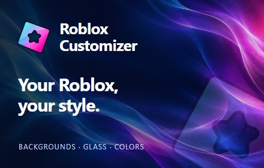

  

<h1 align="center">Roblox Customizer</h1>

<h2 align="center">打造属于你的 Roblox。</h2>

适用于 Chrome 和 Edge 的浏览器扩展，为 Roblox 添加自定义背景、毛玻璃面板和实用工具，支持浅色与深色主题。

[English](README.md) · 简体中文

## 预览

  

  

## 主要功能

- **自定义背景：** 支持本地图片、GIF 和 MP4 视频，可调整图片适应方式及背景暗度。
- **界面外观：** 调整毛玻璃的模糊程度和不透明度，并体验文字、背景及强调色的实验性配色功能。
- **个性化主页：** 自定义问候语和时钟，显示最多三行好友，整理置顶游戏与文件夹，并管理推荐内容。
- **本地游戏时长：** 按账号记录时长估算，提供主页摘要、可搜索的历史记录和 JSON 导出；可在设置中暂停记录。
- **游戏工具：** 查看徽章和通行证信息，使用私人服务器卡片，并按国家、延迟、Ping 和玩家人数筛选公共服务器。
- **社交动态：** 分别为游戏、社区和个人资料页面启用 X 与 YouTube 动态。
- **Robux 价值估算：** 在 Roblox 和 Creator Hub 显示货币价值参考，实际结算价格可能不同。

## 安装

1. 下载或克隆此仓库；如果下载的是 ZIP 文件，请先解压。
2. 打开 `chrome://extensions` 或 `edge://extensions`，启用 **开发者模式**。
3. 点击 **加载已解压的扩展程序**，选择包含 `manifest.json` 的文件夹。
4. 刷新 Roblox，点击浏览器工具栏中的扩展图标，或从 Roblox 齿轮菜单打开 **Roblox 自定义工具**。

安装时无需构建。请将扩展文件夹保留在固定位置。

安装后首次访问 Roblox 网站时，会自动弹出服务条款提示。此浏览器会记住接受状态，即使使用 **重置全部** 也不会重复提示。

## 快速上手

- 在 **外观** 中选择背景，调整适应方式、暗度、模糊程度和不透明度。更改会自动保存。
- 在游戏页面点击 **置顶游戏**，选择文件夹并确认；在主页的 **置顶游戏** 区域管理文件夹。
- 打开游戏的 **服务器** 标签页，设置筛选条件后点击 **搜索**。
- 使用 **备份与恢复** 导出设置、背景、置顶游戏和时长记录。导入会替换现有扩展数据。

## 语言支持

完整功能要求 Roblox 使用 **英语、简体中文或繁体中文**。其他语言会进入回退模式：仅保留图片／GIF 背景和自定义颜色，并保持 Roblox 原生页面布局。

切换 Roblox 的语言即可恢复完整功能。仅更改扩展的界面语言不会退出回退模式。

## 数据与使用限制

设置、背景、置顶游戏和时长记录保存在当前浏览器本地。游戏时长根据浏览器运行期间的 Roblox 状态估算，无法补记过去的会话或浏览器关闭期间的时间。

服务器数据、社交动态和汇率依赖 Roblox 及外部服务，暂时不可用时可稍后重试。卸载前请导出备份，并使用 **重置全部** 一并删除已保存的背景和网站缓存。

请阅读[隐私政策](PRIVACY.zh-CN.md)和[服务条款](TERMS.zh-CN.md)，也可从设置菜单打开。如需支持或咨询隐私问题，请联系 [lunar@lunarfox.my](mailto:lunar@lunarfox.my)。

## 更新与反馈

替换扩展文件后，重新加载扩展并刷新 Roblox。反馈问题时，请提供页面链接、浏览器版本、复现步骤和截图。

修改后台脚本后，请运行 `node scripts/build-service-worker.cjs` 更新仓库中的后台脚本包。

政策文本维护在 `src/legal/content.json`；修改后请运行 `node scripts/build-legal-docs.cjs` 更新公开文件。

本项目采用 [GNU GPL v3](LICENSE) 许可证。
