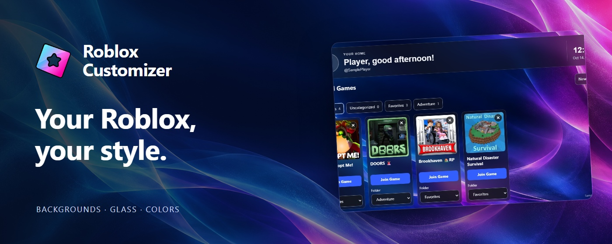

<a id="top"></a>

<p align="center">
  
</p>

<h1 align="center">✨ Roblox Customizer</h1>

<p align="center">
  
</p>

<p align="center">
  为 Roblox 添加自定义背景、毛玻璃面板，以及主页、好友、头像、游戏和服务器工具。<br>
  适用于 Chrome 和 Edge，支持浅色与深色主题。
</p>

<p align="center">
  🧩 Chrome · Edge &nbsp; 🌓 浅色与深色 &nbsp; 💾 本地保存 &nbsp; 🌍 7 种语言
</p>

<p align="center">
  <a href="https://chromewebstore.google.com/detail/roblox-customizer/docflecekjjcekdcapolmneiomimiboi">
    
  </a>
</p>

<p align="center">
  <a href="README.md">English</a> · <strong>简体中文</strong> · <a href="README.zh-TW.md">繁體中文</a> · <a href="README.id.md">Bahasa Indonesia</a> · <a href="README.ja.md">日本語</a> · <a href="README.th.md">ไทย</a> · <a href="README.ko.md">한국어</a>
</p>

<p align="center">
  <a href="#installation">安装</a> ·
  <a href="#quick-start">快速上手</a> ·
  <a href="#features">功能介绍</a> ·
  <a href="#languages">语言支持</a> ·
  <a href="#data-and-backups">数据与备份</a> ·
  <a href="#troubleshooting-and-feedback">帮助</a>
</p>

<details>
<summary><strong>🖼️ 预览</strong></summary>

<p align="center">
  
</p>

</details>

---

<a id="installation"></a>

## 📦 安装

从 [Chrome 应用商店](https://chromewebstore.google.com/detail/roblox-customizer/docflecekjjcekdcapolmneiomimiboi)安装后，刷新已经打开的 Roblox 页面。

<details>
<summary><strong>在 Chrome 或 Edge 中手动加载仓库</strong></summary>

1. 下载或克隆此仓库；如果下载的是 ZIP 文件，请先解压。
2. 打开 `chrome://extensions` 或 `edge://extensions`，启用 **开发者模式**。
3. 点击 **加载已解压的扩展程序**，选择包含 `manifest.json` 的文件夹。
4. 刷新 Roblox。

仓库已包含运行扩展所需的文件，安装时无需构建。请将扩展文件夹保留在固定位置。

手动更新时，替换文件后在扩展管理页点击 **重新加载**，再刷新 Roblox。

</details>

首次访问时，扩展会提示你接受服务条款。此浏览器会记住接受状态，即使使用 **重置全部** 也会保留。

首次进入 Roblox 网页时，导览会在语言和扩展兼容性提示结束后自动显示，介绍两种设置入口：**Roblox 齿轮 → Roblox Customizer**，或点击**浏览器工具栏的 Roblox Customizer 图标**，并提供 **打开设置** 按钮。更新公告接在导览之后显示，都不需要先打开插件设置。导览和公告分别记住关闭状态；新公告编号只会重新显示公告。

<a id="quick-start"></a>

## 🚀 快速上手

打开 Roblox 后，点击浏览器工具栏中的扩展图标，或从 Roblox 齿轮菜单打开 **Roblox 自定义工具**。设置会自动保存。

| 设置分类 | 可以管理的内容 |
| --- | --- |
| **外观** | 背景文件、暗度、毛玻璃模糊与不透明度、透明效果、自定义配色和网页字体。 |
| **主页** | 首页横幅、问候语、时钟、好友行数、推荐内容、游戏时长和最近服务器记录。 |
| **置顶游戏** | 启用或停用置顶功能，查看已保存的游戏和文件夹。 |
| **社交** | 分别为游戏、社区和个人资料页面启用 X 与 YouTube 动态。 |
| **货币** | Robux 价值估算及显示货币。 |
| **语言与数据** | 扩展语言、备份、恢复和重置。 |

置顶游戏时，在游戏页面点击 **置顶游戏** 并选择文件夹。置顶好友时，可在对方个人主页点击 **置顶好友**，或从首页、自己的好友页面打开 **管理置顶好友**。

在 **主页 → 首页好友** 中，可分别开关 **显示原版好友列表** 和 **显示置顶好友**。关闭只隐藏首页模块，保留置顶名单，刷新后仍记住选择。

在 **主页 → 首页横幅** 中关闭 **显示横幅背景框**，可去掉最外层的毛玻璃背景和边框，同时保留头像、问候语、时钟和游玩记录卡片。选择会自动保存。

<a id="features"></a>

## ✨ 功能介绍

### 🎨 外观与主页

- 使用本地图片、动态 GIF 或 MP4 视频作为背景，调整适应方式和暗度。
- 调整毛玻璃的模糊程度与不透明度，也可关闭模糊和透明效果。实验性配色支持自定义文字、背景和强调色。
- 加载 TTF、OTF、WOFF 或 WOFF2 本地字体文件，最大 32 MB。可预览、暂时停用或恢复默认字体；缺少的字符会使用备用字体。
- 自定义首页问候语和时钟，分别控制整条横幅、头像、名称、问候语、时间、日期和最常玩游戏卡片的显示。
- 将原版好友列表展开为最多三行，在首页集中显示置顶好友，并用文件夹整理置顶游戏。
- 控制收藏、精选游戏和推荐区域的显示，或单独隐藏不想看到的推荐游戏。

### 👥 好友与追踪者

好友工具在 Roblox 原版工具栏和卡片上增加功能，保留原来的头像、菜单、聊天、加入游戏和分页。

- 按在线、游戏中、离线、Studio 或置顶状态筛选好友，支持按显示名称、用户名、在线优先和置顶优先排序。
- 在原版卡片上勾选用户，翻页后仍保留选择；也可选择当前页或全部筛选结果。
- 批量解除好友关系、取消关注、接受或忽略好友请求。提交前会显示所选名单；执行时显示进度和失败结果，可在当前操作结束后停止后续处理。
- 从好友个人主页、原版好友列表或置顶好友管理窗口直接置顶、取消置顶。置顶记录在当前浏览器中按 Roblox 账号分别保存。
- 在 Roblox 计数接口可用时，于原版追踪者标题中显示完整总数，替代 `500+` 的上限显示。

解除好友关系会修改 Roblox 账号中的关系，扩展无法撤回。置顶只调整本地首页列表。

### 🎮 游戏与服务器

- 在游戏页面查看徽章、通行证信息和私人服务器卡片，并使用 **游戏备注** 面板。
- 按人数范围、未满状态、国家、城市和 Ping 搜索公共服务器，支持连接排序、随机打乱、随机加入和城市偏好回退。
- 在交互式地球仪上拖动、缩放、点击国家，或搜索国家名称来选择地区。
- 数据可用时显示服务器性能、Roblox 提供的语言匹配人数和运行中的地图发布版本。语言匹配跟随 Roblox 网页语言，不代表已确认玩家实际使用的语言。
- 重新加入最近的服务器、检查可用性，或清空某个游戏的记录。子场景记录归入所属游戏；在 **主页 → 最近的服务器** 中单独控制记录，不受游戏时长开关影响。

服务器筛选条件会在刷新或切换页面后重置。地区与数量取决于已加载的数据；新旧排序需要可靠的启动时间。最近服务器的可用性检查最多扫描 500 个公共服务器，结果不完整时保留为无法确认。已满、关闭或受限制的服务器可能拒绝加入。

### 🧍 头像与动画预览

- 并排使用 Roblox 原生 3D 头像预览和独立的 2D 预览，分类与物品列表适配不同屏幕尺寸。
- 在 **我的头像** 页面展开 **头像工具**，为六个身体部位设置 RGB 颜色，或在 Roblox 允许的范围内调整受支持的已穿戴饰品的位置、旋转和缩放。
- 编辑时先在本地预览，点击 **应用颜色** 或 **应用饰品调整** 后才会修改当前登录的头像。刷新页面可更新 Roblox 原生预览。
- 在动画套装、单个动画和表情商品页点击 **在我的模型上预览**，即可保留当前饰品并播放动作；原版动作选择及播放控制保持同步。

动画预览使用 R15 模型，在本地运行，滚出屏幕或切到后台时暂停。预览动画不会更改当前穿戴或保存造型。

### 🧰 物品详情与资源浏览器

- 在目录、套装、资源库和创作者商店的原版物品详情中补充 ID、可取得的日期和销售或数量数据。支持复制 ID，保留原有购买与试穿控件。
- 按需加载可访问的资源，浏览对象树、查看只读属性、跳转引用、搜索、复制内容和导出文件。
- 支持 XML、JSON、RBXM 模型及 LZ4、Zstandard 压缩，并可预览支持的图片、音频和视频。

资源访问遵循 Roblox 权限，查看时不会执行文件。加载上限为 32 MB、5,000 个模型对象和 128 MB 的展开二进制块。文本预览最多显示 131,072 个字符；复制与文本导出保留可取得的完整值。

### ⏱️ 游戏时长、备注、动态与货币

- **游戏时长：** 按账号估算，提供首页摘要、可搜索的历史记录和 JSON 导出，可在设置中暂停。时长根据浏览器运行期间的 Roblox 状态估算，无法补记过去的会话或浏览器关闭期间的时间。
- **游戏备注：** 每个游戏页面可保存最多 5,000 个字符的私人备注，输入后自动保存。当前浏览器内的 Roblox 账号共用备注，内容不会发布到 Roblox。
- **社交动态：** 在受支持的游戏、社区和个人资料页面显示 X 与 YouTube 动态，并按页面类型分别开关。
- **Robux 估算：** 在 Roblox 和 Creator Hub 显示货币价值参考，实际结算价格可能不同。

<a id="languages"></a>

## 🌐 语言支持

完整页面增强支持 **英语、简体中文、繁体中文、印尼语、日语、泰语和韩语**。

在 **语言与数据 → 扩展语言** 中选择界面语言，或使用 **自动** 跟随 Roblox。支持 `/ja/`、`/th/`、`/ko/` 等本地化页面路径。

Roblox 使用其他语言时，扩展会进入回退模式：保留图片／GIF 背景、自定义配色和字体，并保持原生布局。将 **Roblox 网页语言** 改为受支持的语言即可恢复完整功能；仅更改扩展界面语言不会退出回退模式。

<a id="data-and-backups"></a>

## 💾 数据与备份

设置和保存的内容存于当前浏览器。读取 Roblox 数据、动态、汇率或服务器地区的功能会连接对应服务，详见[隐私政策](PRIVACY.zh-CN.md)。

| 数据 | 保存范围 | 完整设置备份 |
| --- | --- | --- |
| 设置、背景文件和字体文件 | 当前浏览器 | 包含 |
| 置顶游戏与文件夹 | 当前浏览器内的 Roblox 账号共用 | 包含 |
| 置顶好友 | 各 Roblox 账号分别保存 | 包含 |
| 游戏时长 | 各 Roblox 账号分别保存 | 包含已保存的历史记录 |
| 游戏备注 | 当前浏览器内的 Roblox 账号共用 | 包含 |
| 最近服务器 | 各 Roblox 账号分别保存 | 不包含 |
| 当前服务器筛选条件 | 仅当前页面 | 不包含 |

最近服务器为最近使用的十个账号分别记录，每个游戏最多保留六个服务器。无法恢复 Roblox 未提供的服务器 ID。

在 **语言与数据 → 备份与恢复** 中导出或导入完整备份。**导入会替换现有扩展数据。** 重置或迁移到其他浏览器前，请先导出备份。

**重置全部** 会删除已保存的扩展数据，包括备注和最近服务器记录，并清理受支持的网站缓存；服务条款接受状态会保留。若要在卸载前删除保存的数据，请在扩展仍安装时执行重置。

更多说明见[隐私政策](PRIVACY.zh-CN.md)和[服务条款](TERMS.zh-CN.md)。扩展内的政策链接会按界面语言打开 GitHub 上已发布的文档。

<a id="troubleshooting-and-feedback"></a>

## 🛠️ 问题排查与反馈

- **更新后没有变化：** 手动安装时，先在 `chrome://extensions` 或 `edge://extensions` 中重新加载扩展，再刷新 Roblox。只刷新网页可能无法载入 manifest 或后台脚本的更新。
- **部分增强功能没有显示：** 检查 Roblox 网页语言是否在上述支持列表中；依赖接口的功能也可能暂时不可用。
- **元素重叠或页面行为异常：** 其他扩展可能修改同一处元素。兼容性提醒可识别部分已知 Roblox 扩展；排查时可按需调整重复功能，提醒本身不会禁用其他扩展。
- **数据加载失败：** Roblox 或外部服务恢复后可重试。扩展无法补充接口未提供的服务器字段，也无法绕过资源访问权限。

需要帮助时，请发送邮件至 [lunar@lunarfox.my](mailto:lunar@lunarfox.my)，附上受影响的页面链接、浏览器及版本、Roblox 语言、复现步骤和截图。

<a id="development"></a>

## 🧑‍💻 开发说明

安装可直接使用仓库中的文件。开发和测试需要 Node.js。

**编辑更新公告：** 英文保存在 [UPDATE.md](UPDATE.md)，简体中文保存在 [UPDATE.zh-CN.md](UPDATE.zh-CN.md)，其他语言分别使用 `UPDATE.zh-TW.md`、`UPDATE.id.md`、`UPDATE.ja.md`、`UPDATE.th.md`、`UPDATE.ko.md`，可独立编辑。弹窗按插件当前语言读取，切换语言时更新正文；对应文件缺失或格式错误时回退到英文。各语言保持相同 `id`，避免切换语言重复弹出。修正文案时保留编号，发布新公告时将各语言统一改为新编号（如 `1.2.1`）。`enabled: false` 只停用该语言公告，不回退到英文。无需打包，重新加载扩展并刷新 Roblox 即可。用户也可从设置底部的 **更新公告** 随时重看。

修改源码后，重新生成对应文件：

| 修改内容 | 命令 |
| --- | --- |
| 后台模块及其打包依赖 | `node scripts/build-service-worker.cjs` |
| 网页桥接、路径工具、兼容检查、服务器卡片或原版好友适配脚本 | `node scripts/build-page-bridge.cjs` |
| `src/legal/content.json` 中的政策文本 | `node scripts/build-legal-docs.cjs` |

检查脚本包，并运行扩展资源、文字识别和备份的针对性检查：

```sh
node scripts/build-service-worker.cjs --check
node scripts/build-page-bridge.cjs --check
node --test tests/extension-package.test.cjs tests/native-labels.test.cjs tests/backup.test.cjs
```

浏览器测试使用独立配置和本地模拟页面，运行前需将 `CHROME_BIN` 指向 Chrome 或 Chromium。真实扩展注入测试还需要设置 `CHROME_EXTENSION_TESTS=1`，使用支持加载已解压扩展的 Chrome for Testing 或 Chromium，并将 `SERVER_VIEW_REACT_BUNDLE` 指向 Roblox React 脚本的本地副本：

```sh
node --test tests/extension-server-metadata-browser.test.cjs
```

资源浏览器的属性与枚举参考数据可通过 `node scripts/build-model-schema.cjs` 更新。

<a id="license-and-credits"></a>

## 📜 许可证与致谢

本项目采用 [GNU GPL v3](LICENSE) 许可证。随附第三方组件保留各自的许可证和声明，包括 [fzstd](src/assets/vendor/fzstd.LICENSE)及[动画预览渲染器与依赖](src/assets/animation-preview/vendor/README.md)。

---

<p align="center">
  <a href="#top">⬆️ 返回顶部</a>
</p>
